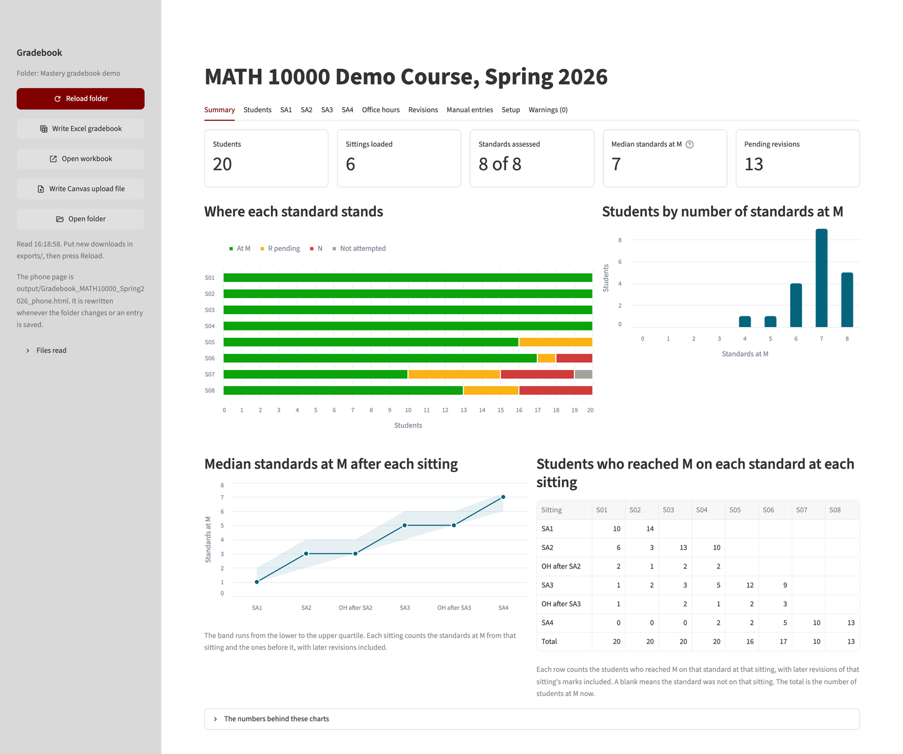
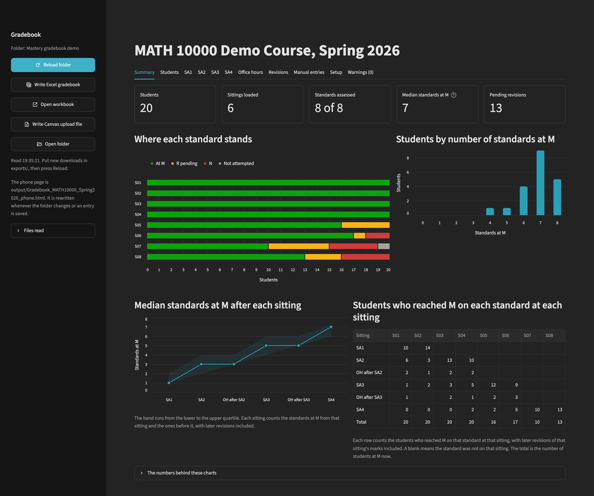
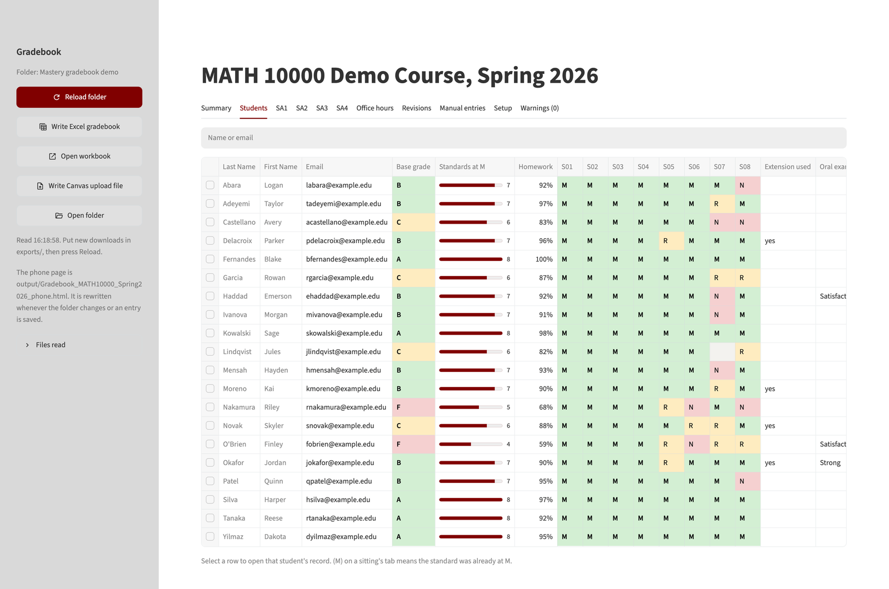
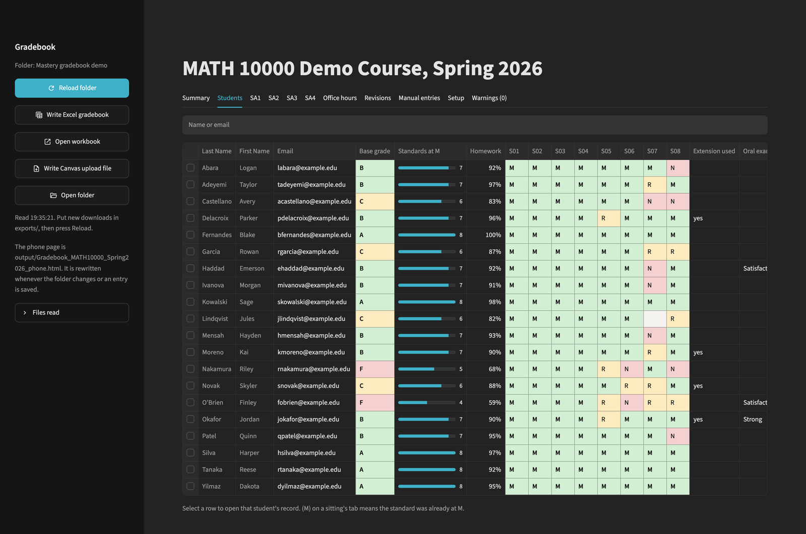
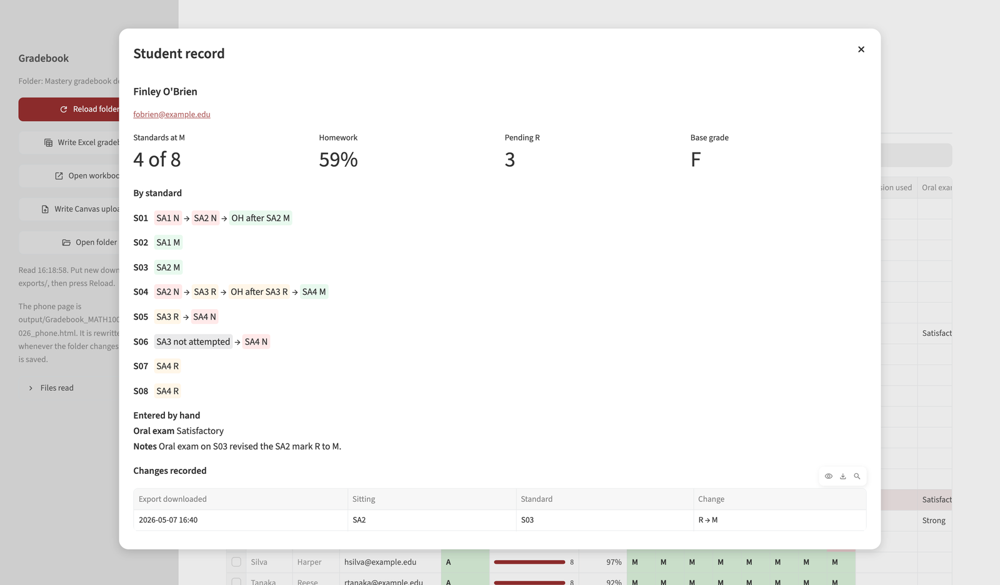
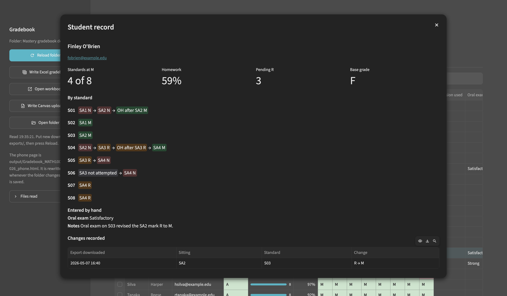
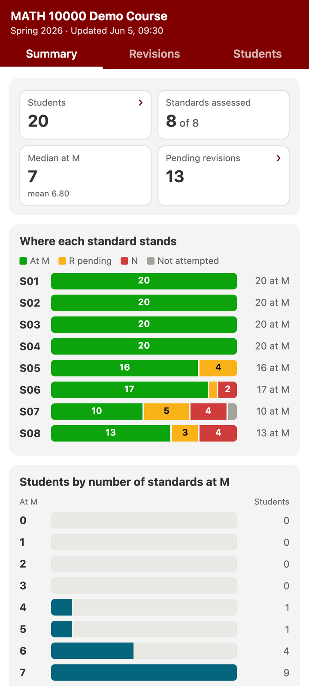
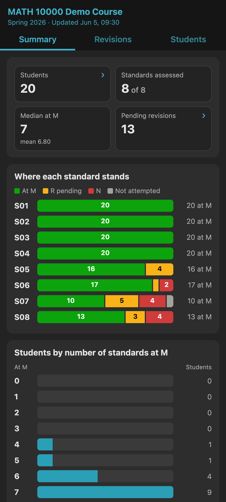


  Each screenshot comes in a light and a dark version, and css/stylesheet.scss
  (SCREENSHOTS) shows the one that matches the site's theme. Both versions are
  of the invented demo course; the light ones were captured on 2026-11-13 from
  the demo copy, the dark ones the same evening at the same window size.

  Each figure carries markdown="0". _config.yml sets parse_block_html, and
  without the attribute kramdown reads the caption as a paragraph that swallows
  </figcaption> and </figure>, nesting every later figure inside the one before.






I use mastery-based grading (also called standards-based grading) in my courses. Each standard gets its own question on my Gradescope assessments and its own assignment in my Canvas gradebook. But Gradescope passes only an assessment's total score back to Canvas, and from the total I can't tell which standards a student has mastered. In October 2026 I made this dashboard with Claude Code to fill in those Canvas assignments from the Gradescope exports.

It keeps each student's best mark on each standard across all assessments, including office-hour reassessments and revisions. From those marks it writes a file that I import into Canvas. It also shows a summary of the whole class and a record for each student, and it writes an Excel workbook and a read-only page for my phone. Anything I type in by hand, such as a note or the final grade, is saved as soon as I leave the cell. It runs on my own computer and doesn't send student data anywhere.

If you grade by standards and give each standard its own question in Gradescope, it should work for your course too. On its Setup tab you choose the mark levels, which of them count as mastered, and the checklist for the base grade.

The course and the students in the screenshots below are made up.

<figure class="shot" markdown="0">
  
  
  <figcaption>The Summary tab.</figcaption>
</figure>

<figure class="shot" markdown="0">
  
  
  <figcaption>The Students tab, with one row per student and the base grade from the checklist.</figcaption>
</figure>

<figure class="shot" markdown="0">
  
  
  <figcaption>One student’s record, with each standard’s marks from the first assessment to the last.</figcaption>
</figure>

<figure class="shot shot--phone" markdown="0">
  
  
  <figcaption>The phone page.</figcaption>
</figure>

[Download the folder](/pedagogy/gradebook/mastery-gradebook.zip) (zip, 72 KB). It needs Python 3.11 or later. If Python or one of the packages the dashboard uses is missing, the launchers for Mac and Windows offer to install it. The README in the folder explains the setup.


