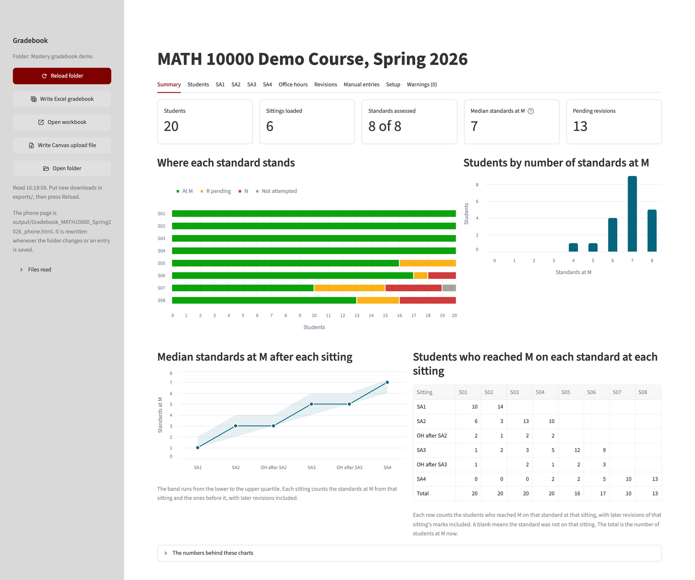
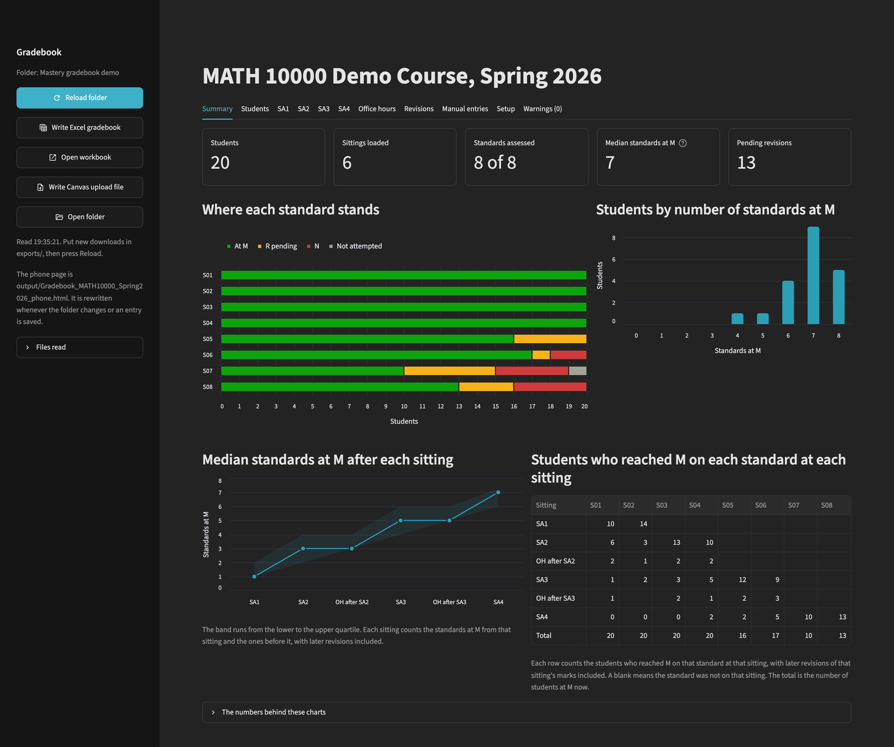
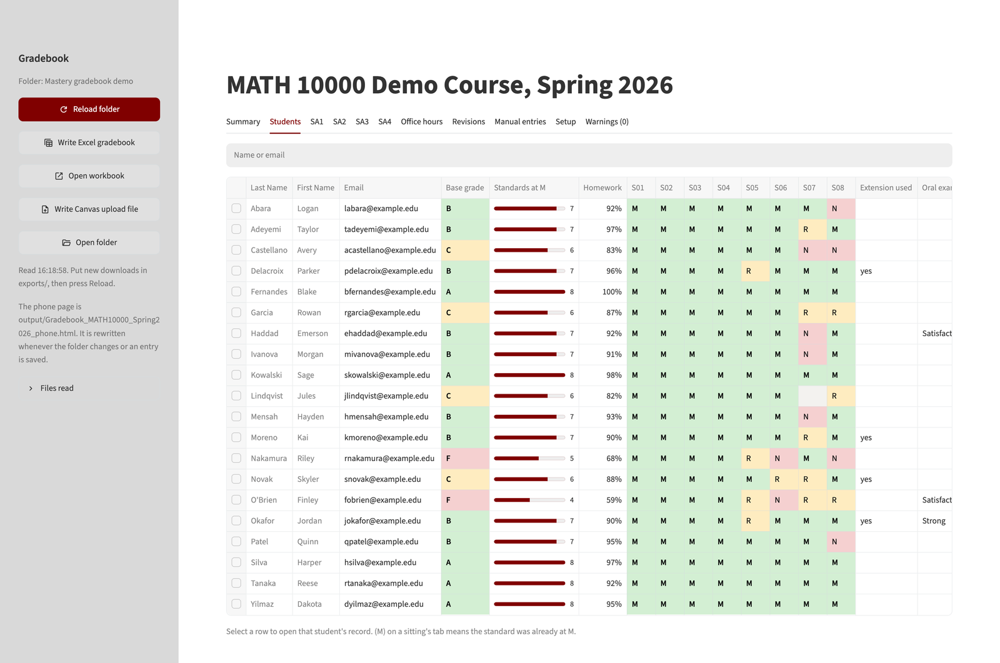
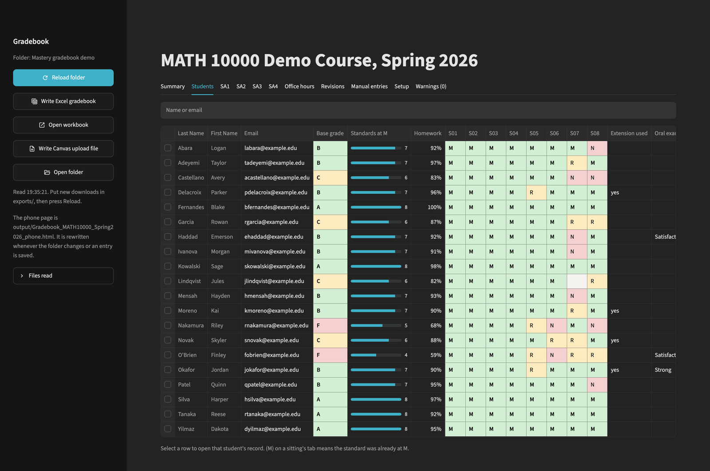
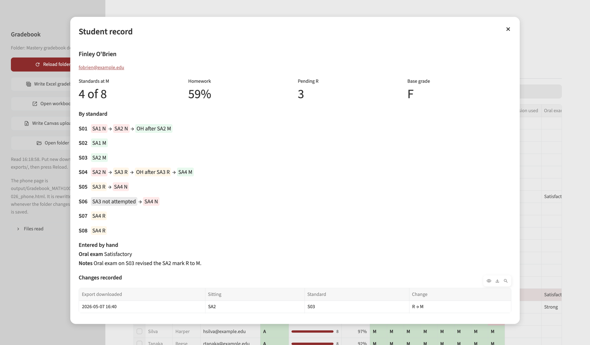
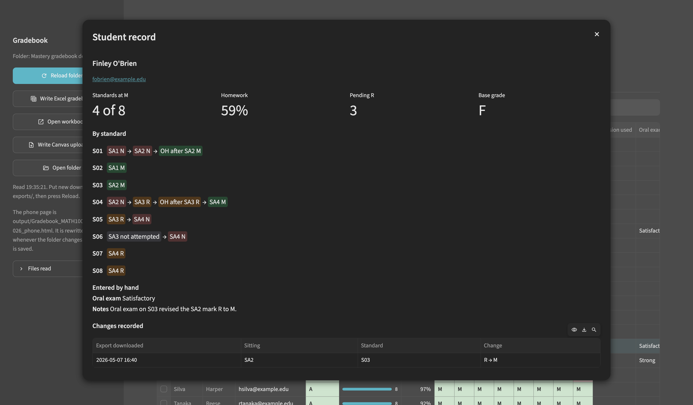
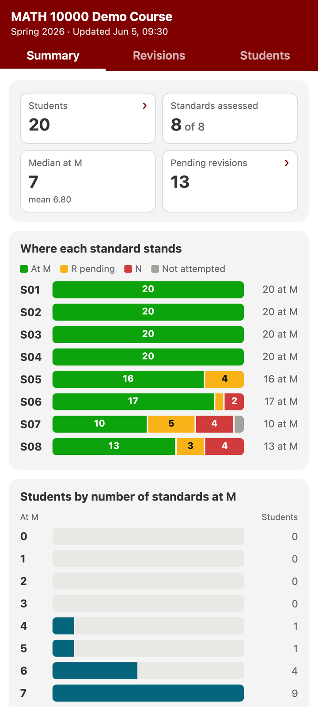
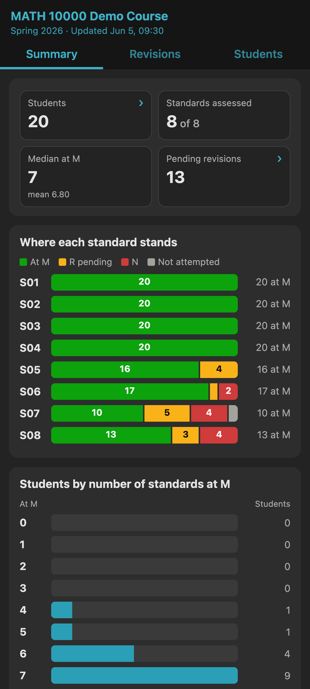


  Each screenshot comes in a light and a dark version, and css/stylesheet.scss
  (SCREENSHOTS) shows the one that matches the site's theme. Both versions are
  of the invented demo course; the light ones were captured on 2026-11-13 from
  the demo copy, the dark ones the same evening at the same window size.






Gradescope passes only an assessment's total score back to Canvas. My standards assessments have one question per standard, and my Canvas gradebook has one assignment per standard. In October 2026 I made this dashboard, with Claude Code, to go in between.

It keeps each student's best mark on each standard across all assessments, office-hour reassessments and revisions included, and writes a file to import into Canvas. It also shows where the class and each student stand, and writes an Excel workbook and a read-only page for my phone. Anything I enter by hand is saved as soon as I leave the cell. It runs on my own computer, and no data leaves it.

If you grade by standards and use Gradescope, it should work for your course too. You set the mark levels, what counts as mastered, and the checklist for the base grade.

The screenshots below show an invented course with made-up students.

<figure class="shot">
  
  
  <figcaption>The summary page.</figcaption>
</figure>

<figure class="shot">
  
  
  <figcaption>One row per student, with the base grade from the checklist.</figcaption>
</figure>

<figure class="shot">
  
  
  <figcaption>One student's record, with each standard's marks in order.</figcaption>
</figure>

<figure class="shot shot--phone">
  
  
  <figcaption>The phone page.</figcaption>
</figure>

[Download the folder](/teaching/gradebook/mastery-gradebook.zip) (zip, 72 KB). It has launchers for Mac and Windows and a README, and it needs Python 3.11 or later. The launchers offer to install what is missing.


